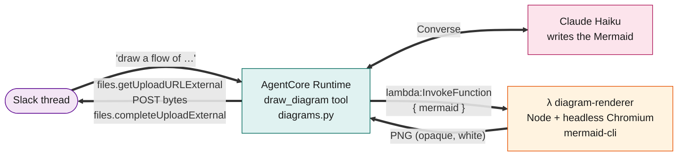

# Diagrams and charts (`draw_diagram`)

Slack shows Mermaid source as plain text, so when a picture explains the answer better, the bot posts one: a flow, a sequence of calls, a timeline, or a chart of numbers someone pasted or attached. It is off unless `diagram_renderer_enabled = true`.

> **Where the diagram source goes.** It is rendered by a Lambda **in your own AWS account**. It is never sent to a third party, and the renderer never logs it. See [Security](#security).

- [How it works](#how-it-works)
- [Turn it on](#turn-it-on)
- [What it can draw](#what-it-can-draw)
- [Sample prompts for SRE work](#sample-prompts-for-sre-work)
- [Limits](#limits)
- [Security](#security)
- [Run the renderer locally](#run-the-renderer-locally)
- [Testing](#testing)
- [Design notes](#design-notes)

## How it works



1. The model decides a picture helps (or the user asks for one) and calls `draw_diagram(mermaid, title)` with Mermaid source.
2. [diagrams.py](../backends/agents/slack_agent/src/diagrams.py) sends the source to the renderer Lambda with an IAM-signed `Invoke`.
3. The Lambda ([index.mjs](../backends/diagram_renderer/index.mjs)) renders it with mermaid-cli in headless Chromium and returns a PNG as base64.
4. The agent uploads the PNG with Slack's external upload flow and shares it in the thread. The bot token goes only to `slack.com`, and the bytes are posted to Slack's upload URL without it.
5. The tool tells the model the image is posted, and the model adds a line or two about what it shows. It must not paste the Mermaid source.

**If Mermaid rejects the source**, the parse error goes back to the model ("Parse error on line 3 … Expecting …"), which can fix it and call the tool again. At most **3 attempts per reply**, failures included, so a bad diagram can't loop.

The tool exists only when all of these hold ([main.py](../backends/agents/slack_agent/src/main.py), `diagrams.enabled`): `DIAGRAM_RENDER_FUNCTION` is set, the worker passed the channel and thread timestamp, and the agent has a bot token. Otherwise the model never sees it and answers in text.

## Turn it on

| Step | Where |
|---|---|
| 1. Add the `files:write` bot scope, **Reinstall to Workspace**, and store the new bot token again | [slack-setup.md](slack-setup.md#1-create-the-app-from-a-manifest) (the [manifest](slack-app-manifest.yaml) already has it) |
| 2. Set `diagram_renderer_enabled = true` | [app-infra-params.tfvars](../infra-as-code/tf-vars/dev/app-infra-params.tfvars) |
| 3. `make deploy` | Builds the renderer image (a few minutes the first time) and rebuilds the agent image |
| 4. Ask for a diagram in a **new thread** | A warm runtime session can still be running the old container |

What Terraform creates ([diagrams.tf](../infra-as-code/tf-app/diagrams.tf)):

| Resource | Notes |
|---|---|
| ECR repository `<prefix>-diagram-renderer` | linux/arm64 image built from [backends/diagram_renderer](../backends/diagram_renderer) |
| Lambda `<prefix>-diagram-renderer` | 2048 MB, 30 s timeout. Its role can write its own logs and nothing else: no secrets, tables or queues |
| `lambda:InvokeFunction` on that one function | Added to the agent runtime's role only |
| `DIAGRAM_RENDER_FUNCTION` on the runtime | The function name. Empty (the default, `diagram_renderer_enabled = false`) removes the tool |

There is no public URL: the only way in is an IAM-signed invoke from the agent role.

## What it can draw

All of Mermaid, so anything the model can write as a diagram. These are the ones that matter for answers in a thread:

| Goal | Mermaid type | Notes |
|---|---|---|
| Flow, decision path, alert routing | `flowchart` | Keep to about 15 nodes |
| Who calls whom, a failing request | `sequenceDiagram` | |
| Lifecycle (incident states) | `stateDiagram-v2` | |
| Incident phases, schedules | `gantt` | |
| Timeline of events | `timeline` | |
| **Line chart** (latency, error rate over time) | `xychart-beta` | Several `line` series on one axis, for example data plus an SLO line |
| **Bar chart** (alerts per service) | `xychart-beta` | |
| **Pie chart** (alerts by cause) | `pie` | |
| Noise vs impact | `quadrantChart` | |
| Where traffic or errors go | `sankey-beta` | |

The renderer uses a stronger colour palette than Mermaid's default, whose chart series are near-white and unreadable. It draws on an **opaque white** background at 2× resolution, so labels stay readable on Slack's dark theme.

## Sample prompts for SRE work

The bot has no metrics tool. It draws numbers you **paste or attach** and never invents them. Name the chart type, the units and a title, and say what each line means.

```text
@bot line chart of p99 latency in ms by hour with a flat 500 ms SLO line. Blue is p99, red is the SLO.
     Data: 00:00 210, 04:00 190, 08:00 340, 12:00 820, 16:00 460, 20:00 250
@bot bar chart "Alerts by service this week": payments 142, auth 87, search 41, orders 23
@bot pie chart of last month's alerts by cause: noisy threshold 48, deploy 21, capacity 12,
     dependency 9, real incident 4. What does it say about alert quality?
@bot gantt of this incident: detect 14:09-14:12, triage 14:12-14:20, mitigate 14:20-14:26. Which phase took longest?
@bot timeline: 14:02 deploy v2.41, 14:09 error rate hits 6%, 14:12 first page, 14:20 rollback, 14:26 recovered
@bot draw a sequence diagram of how a checkout request failed: client > gateway > orders > payments (timeout) > retry storm
@bot state diagram of the incident lifecycle: detected, acknowledged, investigating, mitigated, resolved, postmortem
```

With an attachment, [alerts.csv](testing-samples/alerts.csv) is the sample:

```text
@bot chart the top 10 noisiest alerts as a bar chart, then tell me which three to retune
```

Follow-ups in the same thread work because the thread is the bot's memory: `now make it a pie chart`, or `add a cache between the Lambda and the agent`.

## Limits

| Limit | Value | Why |
|---|---|---|
| Source length | 6,000 characters (agent), 20,000 (renderer) | Keeps the model's output small. For large data, ask for the top N or an hourly or daily aggregate |
| Diagrams per reply | 3, failed attempts included | A bad diagram can't loop |
| Image size | 4 MB | A synchronous Lambda response is capped at 6 MB, and base64 adds a third |
| Render timeout | 40 s on the agent's side, 30 s on the Lambda | The first render after a quiet period starts Chromium (about 5–10 s) |
| Series legend | None on `xychart-beta` | Say which line is which in the title or the reply |
| Dual axes, stacked bars, annotations | Not supported by Mermaid's xychart | |
| Interactivity | None | Slack shows a static image. Click it for Slack's full-size preview |

## Security

| Question | Answer |
|---|---|
| Does diagram text leave AWS? | No. It goes from the agent to the renderer Lambda in the same account, over an IAM-signed invoke. It does reach Bedrock, as every message does. |
| Can anything else call the renderer? | No. There is no URL. Only the agent's role has `lambda:InvokeFunction` on it. |
| What can the renderer do if a crafted diagram attacks Chromium? | Run inside a Lambda whose role has only log access: no secrets, tables, queues or Slack token. The agent container, which holds the bot token and the runtime's credentials, never runs a browser. |
| Can a diagram inject HTML or script? | Mermaid runs with `securityLevel: "strict"`, so HTML in labels and click handlers are refused. An `` label fails to parse. |
| Is the source logged? | No. The renderer logs only sizes and timings. On a render failure the agent logs the error *type* and never the message, which could quote the diagram. A Mermaid parse error does go back to the model, because it needs it to fix the syntax. |
| Does the bot token go to the renderer? | No. The Lambda never sees it. |
| Outbound network from the renderer | Lambda has internet access. Chromium loads only local assets for rendering, but egress is not blocked. Putting the function in a VPC with no route out would block it, at the cost of a NAT-less network setup. |
| Where does the Chromium binary come from? | [Sparticuz/chromium](https://github.com/Sparticuz/chromium), pinned to a release and **checked against a sha256 in the Dockerfile**, so a changed upstream file fails the build. |

The bot token is only ever sent to `slack.com`: the upload URL Slack returns must be an `https` URL on a `.slack.com` host, or the tool refuses.

## Run the renderer locally

The Lambda image runs under the AWS Lambda Runtime Interface Emulator, so you can render without deploying:

```bash
cd backends/diagram_renderer
docker buildx build --platform linux/arm64 --target lambda --provenance=false --sbom=false --load -t diagram-renderer:test .
docker run -d --name dr-test --platform linux/arm64 -p 9000:8080 --memory 2048m diagram-renderer:test

curl -s -X POST http://localhost:9000/2015-03-31/functions/function/invocations \
  -d '{"mermaid":"flowchart LR\n  A[Slack] --> B[Lambda] --> C[AgentCore]"}' \
  | python3 -c 'import sys,json,base64; open("/tmp/d.png","wb").write(base64.b64decode(json.load(sys.stdin)["png_base64"]))'
open /tmp/d.png

docker rm -f dr-test
```

An invalid diagram answers `{"error":"invalid_source","detail":"Parse error on line 3 …"}`.

**With Tilt**, the agent can use the *deployed* renderer: set `DIAGRAM_RENDER_FUNCTION=<prefix>-diagram-renderer` in `.env`, make sure your AWS profile may `lambda:InvokeFunction` it, and restart Tilt. `.env` is read once at start. There is no local renderer in the Tilt stack, because Chromium doesn't belong in the dev loop.

> Keep `node_modules/` out of `backends/diagram_renderer`. The image tag is a hash of every file in that folder, so installing dependencies there would change it. It is in `.gitignore`.

## Testing

- **Unit tests** ([test_diagrams.py](../backends/agents/slack_agent/tests/test_diagrams.py), `make test`): a fake Lambda client checks the invoke payload, error handling, that a function error never leaks its message, size limits, and that the upload goes only to Slack. They mock the renderer, so they prove the logic and not the real render.
- **The renderer itself:** the local commands above.
- **In Slack:** [testing-guide.md](testing-guide.md#diagrams-and-charts) has the prompts and expected results, locally and deployed.
- **Problems:** [troubleshooting.md](troubleshooting.md#diagrams).

## Design notes

**Why a separate Lambda, not the agent container or a shell tool?** The agent container holds the Slack bot token and the runtime's AWS credentials. Rendering Mermaid the model wrote, which other people's thread text can influence, needs a browser. Keeping that browser in a function with no secrets limits what a browser exploit could reach. A Strands shell tool would be worse: it lets the model run arbitrary commands next to those credentials, and still wouldn't provide a browser.

**Why not kroki.io, or a self-hosted Kroki?** The first version used the public kroki.io, which sends diagram source, possibly org data, to a third party. It also returns HTTP 403 to Python's default user agent, and its PNGs have a transparent background, which made dark labels vanish on Slack's dark theme. A self-hosted Kroki (`yuzutech/kroki` + `kroki-mermaid`) would work, but needs an always-on service plus a public endpoint with auth, because the runtime is not in a VPC. The Lambda is IAM-only and scales to zero.

**Why Mermaid, and not code the model runs?** Mermaid is declarative: the worst a hostile diagram does is fail to parse. Running model-written Python to draw a chart would need a code sandbox.

**Why an image, not Mermaid in the reply?** Slack renders Mermaid as plain text.
